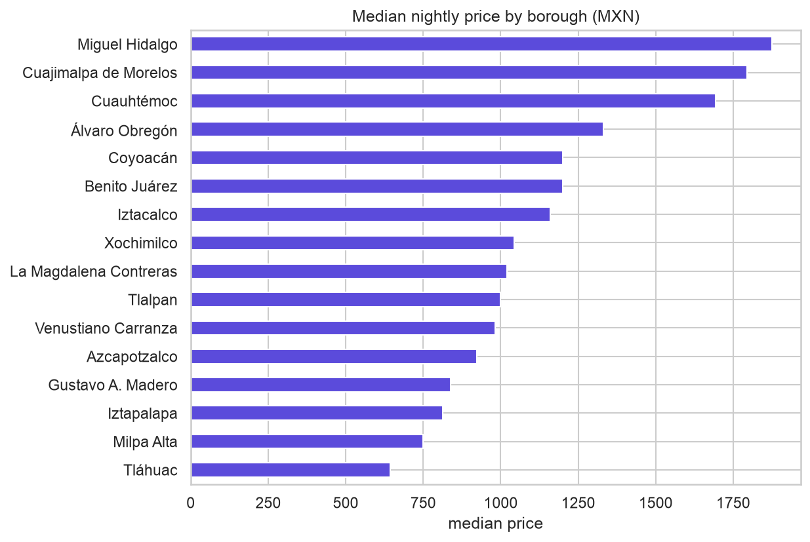

*Work in progress: I'll keep adding to this as the analysis grows.*

## The data

About 30,500 Airbnb listings across Mexico City's 16 boroughs, from [Inside Airbnb](https://insideairbnb.com/get-the-data/) (September 2026), with 90 columns per listing.

## What I'm cleaning

- **Empty or useless columns:** 15 columns are completely empty.
- **Prices stored as text:** `"$1,200.00"` becomes `1200.0` (MXN).
- **Bathrooms as text:** `"1.5 shared baths"` becomes a number plus a bathroom type.
- **Amenities as text:** turned into real lists and yes/no flags (Wi-Fi, kitchen, A/C, …).
- **Outliers:** extreme prices are flagged instead of deleted.
- **Missing values:** a missing review score usually just means *no reviews yet*.

## First look

Miguel Hidalgo, Cuajimalpa and Cuauhtémoc are the most expensive boroughs, and Cuauhtémoc alone has over 13,000 listings.
